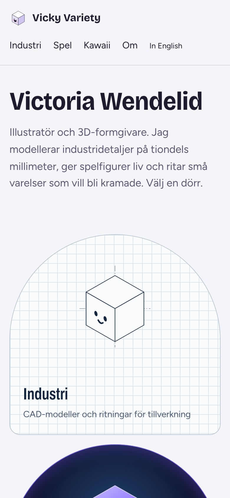
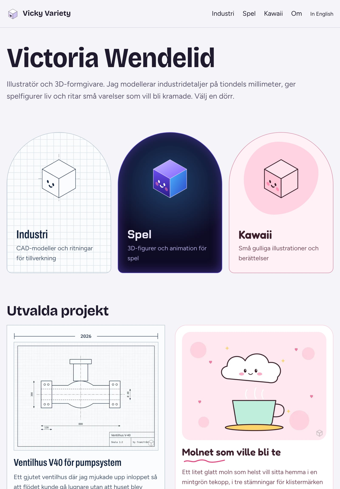
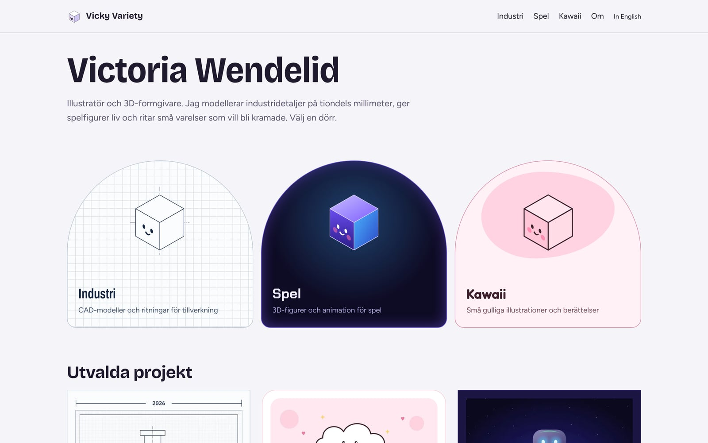
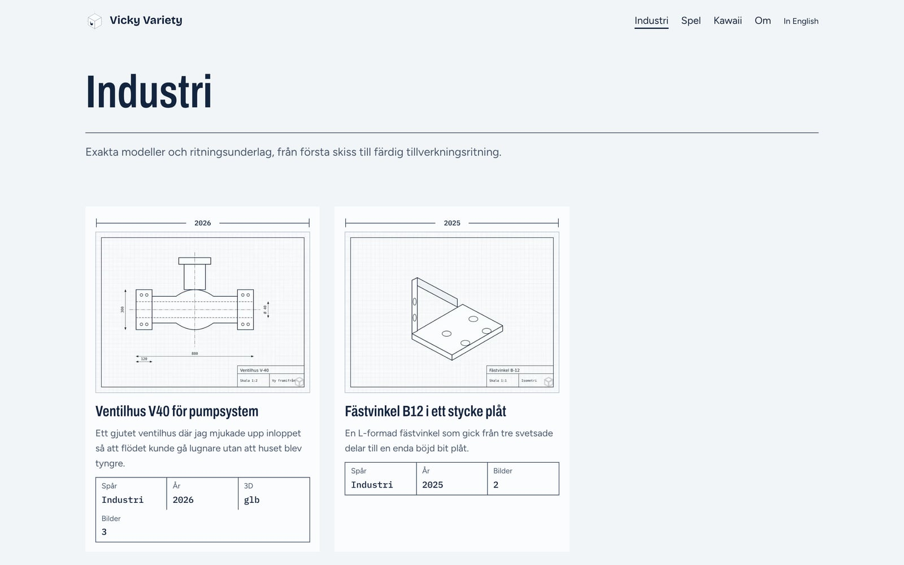
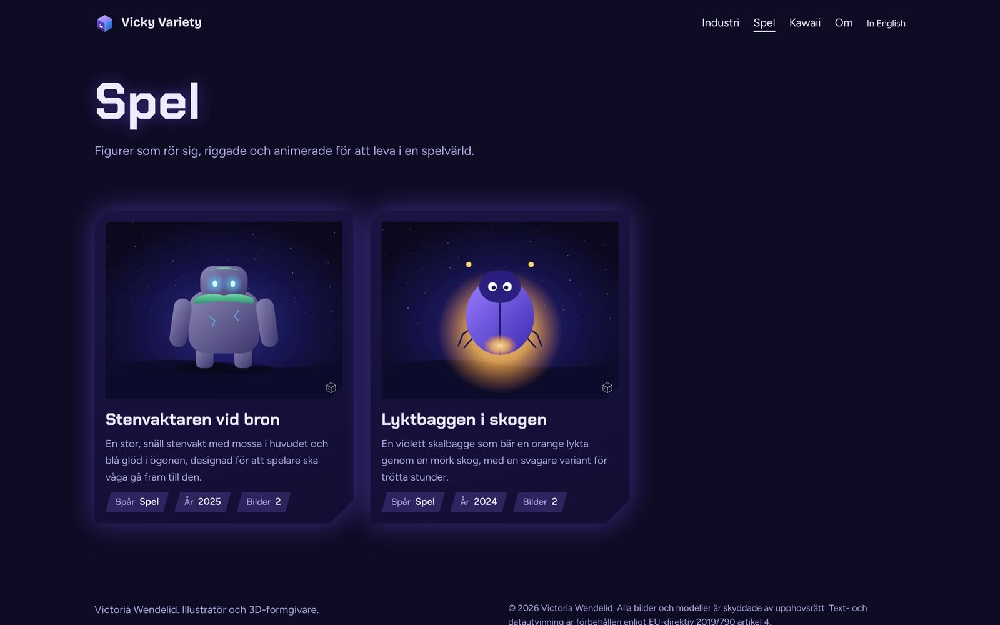
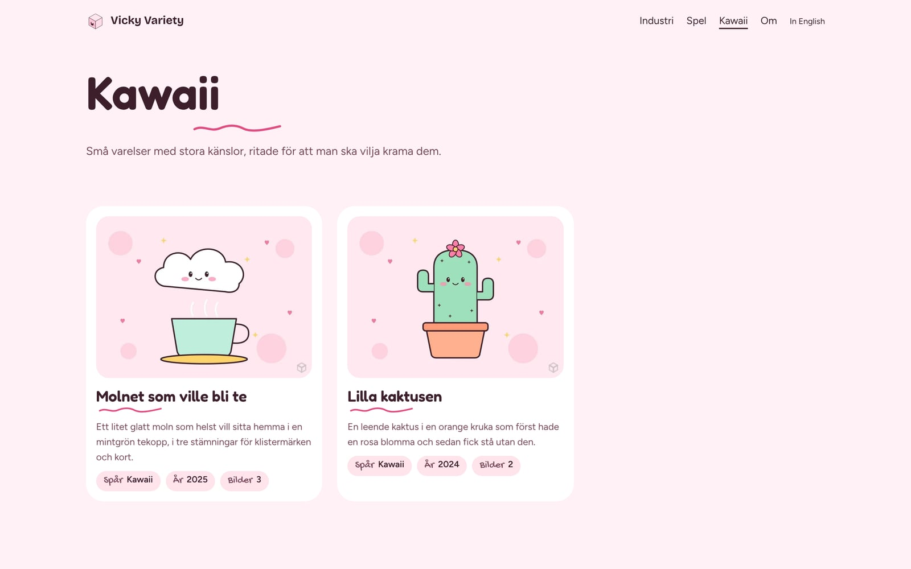
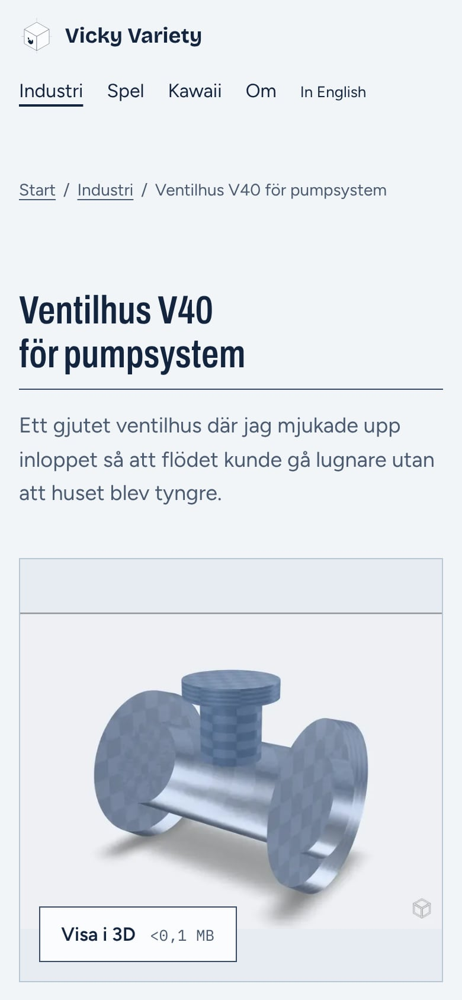
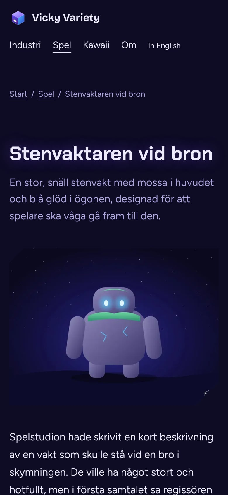
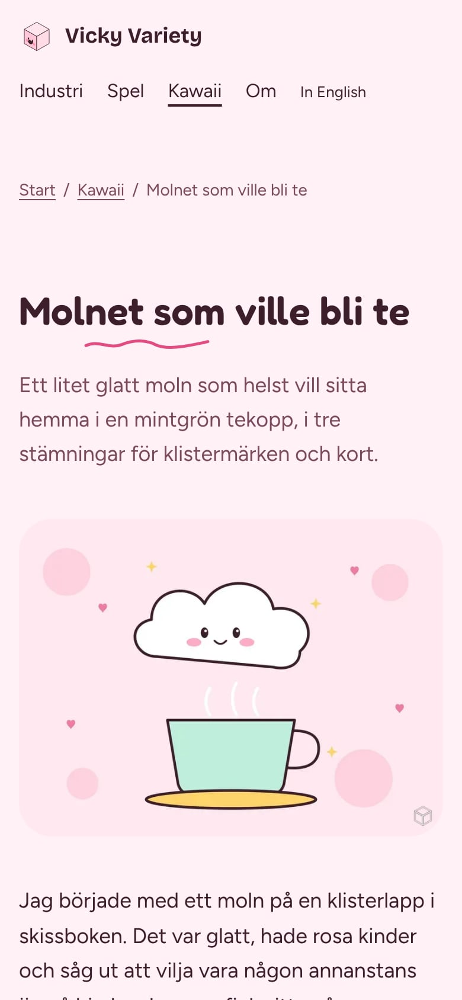

# Vicky Variety: designbrief för portfolion

9 november 2026

## Idén: en människa, tre uttryck

Sajten visar dig som en person med tre uttryck: Industri, Spel och Kawaii. Allt bygger på samma ram, och bara uttrycket skiljer sig mellan spåren. Namnet Vicky Variety blir själva konceptet.

Startsidan är neutral och lekfull, med en dörr in till varje spår. Märket är en kub med ett gulligt ansikte, alltså hård geometri och ett mjukt ansikte i samma figur. Kuben ritas som linjeritning i Industri, glöder i Spel och har rosiga kinder i Kawaii.

Sajten finns på engelska och svenska. Engelska ligger på huvudadressen eftersom spelbranschen och många industrikunder läser engelska först.

| Spår | Känsla | Signaturelement |
| --- | --- | --- |
| Industri | Ritpapper, ritbläck, mycket luft. I mörkt läge blir sidan en blåkopia. | Måttlinjer, rutnät och ritningshuvud |
| Spel | Djup natt i blått och violett, alltid mörkt | Glöd, sneda klippta hörn och figurer som bryter ut ur sin ruta |
| Kawaii | Pastell, runda former och handskrivna detaljer | Handritade understrykningar och mjuka blobbar |

## Så ser sajten ut

Bilderna är skärmdumpar av den svenska versionen som den ser ut nu, med exempelprojekt och påhittade texter. Samma sidor visas i tre skärmstorlekar: mobil (390 px bred), surfplatta (820 px) och dator (1 440 px). Sajten byggs först för mobilen och breddas sedan.

### Startsidan i tre storlekar

På mobilen ligger dörrarna under varandra. På surfplatta och dator står de i en rad.

  
  

### Spårsidorna på dator

Samma ram i alla tre spår. Bara färger, typsnitt, hörn och signaturelement byts.

### Projektsidorna på mobil

Ventilhuset visar 3D-modellens posterbild med knappen Visa i 3D och filstorleken. Modellen laddas först när man trycker.

  
  
  

## Tekniken bakom

Sajten är en statisk webbplats byggd med Astro och publiceras på Cloudflare Pages. Det betyder att varje sida byggs färdig i förväg. Det finns ingen databas och ingen server att underhålla eller uppdatera, och sidorna laddas snabbt.

Du lägger till ett projekt genom att skapa en mapp med bilder och en textfil. När du sparar och pushar till GitHub bygger Cloudflare om sajten automatiskt på någon minut.

| Del | Teknik | Vad den gör |
| --- | --- | --- |
| Ramverk | Astro 7 | Bygger alla sidor i förväg. Sidorna skickar nästan inget JavaScript, så de blir snabba. |
| Teman | CSS med design-tokens | Ett attribut på sidan (`data-spar`) byter färg, typsnitt, hörn, linjer och rörelse. Ramen är densamma i alla spår. |
| Sidbyten | View Transitions | Temat tonar mjukt över när man går in i ett spår. Äldre webbläsare gör ett vanligt sidbyte. |
| Innehåll | Markdown med kontroll av fälten | En `index.md` per projekt. Saknas ett fält stannar bygget med ett meddelande på svenska. |
| Spår och kontakt | `src/config/sajt.ts` | En enda fil bestämmer vilka spår som finns, deras ordning och dina kontaktvägar. |
| Bilder | Egen bildtjänst med sharp | Gör WebP i flera storlekar, begränsar upplösningen och lägger på vattenstämpel. |
| 3D | Googles `model-viewer` | Rotera, zooma, AR på iPhone och Android, laddningsindikator och tillgänglighet. |
| 3D-optimering | gltf-transform och meshopt | Komprimerar modellen och gör om texturer till WebP. Skapar posterbild automatiskt. |
| Film | ffmpeg, H.264 MP4 | Konverterar filmen till ett format som spelas överallt och tar fram en posterbild. |
| Typsnitt | Ligger på den egna servern | Inga anrop till Google Fonts, vilket är bra för integritet och laddtid. |
| Publicering | Cloudflare Pages | Bygger och publicerar automatiskt vid varje push. Har inbyggt skydd mot botar. |

Två saker gör att sajten blir snabb på mobilen. En 3D-modell laddas aldrig när sidan öppnas. Först visas en posterbild, och modellen laddas när besökaren klickar eller när den kommer in i bild. Korta filmer spelar bara när de syns, och aldrig för den som har valt reducerad rörelse eller sparat data.

## Skydden

Skyddet har tre lager. Det publicerade materialet är sämre än originalet. Maskinerna får veta att insamling är förbjuden. Cloudflare stoppar botar som ändå försöker.

| Skydd | Vad det gör | Var det finns |
| --- | --- | --- |
| Begränsad upplösning | Ingen bild publiceras större än 1 800 pixlar på längsta sidan. | Byggsteget |
| Vattenstämpel | Märket läggs diskret i hörnet på alla bilder från 600 pixlars bredd. | Byggsteget |
| Upphovsrätt i bildfilen | Ditt namn, din adress och förbehållet mot AI-träning skrivs in i bildens metadata. | Byggsteget |
| Originalen publiceras aldrig | Originalbilderna kopieras inte till sajten. Original för 3D och film når varken GitHub eller sajten. | Byggsteget och git |
| Förenklade 3D-modeller | Sajten visar komprimerade visningsversioner, aldrig produktionsfiler. | `npm run media` |
| robots.txt | Stänger ute 36 kända AI-botar, till exempel GPTBot, ClaudeBot, CCBot och Google-Extended. | Sajten |
| TDM-förbehåll | Förbehåll mot text- och datautvinning enligt EU:s DSM-direktiv 2019/790 artikel 4, som header och i `/.well-known/tdmrep.json`. | Sajten och Cloudflare |
| noai-taggar | Metataggarna `noai` och `noimageai` på varje sida och i headers. | Sajten |
| Blockering av AI-botar | Cloudflare känner igen AI-botar och blockerar dem innan de når sajten. | Cloudflare, slås på av dig |
| Bot Fight Mode | Utmanar eller blockerar automatiserad trafik. | Cloudflare, slås på av dig |
| AI Labyrinth | Skickar botar som struntar i robots.txt in i en labyrint av meningslösa sidor. | Cloudflare, om det finns |

TDM-förbehållet är det viktigaste juridiska skyddet. Enligt EU-rätten får ett företag inte träna AI på material vars rättighetshavare har reserverat sig i maskinläsbar form, och det är det sajten gör.

## Begränsningar och tanken bakom

Allt som visas i en webbläsare går att spara. En bild som syns på skärmen finns redan i besökarens dator, och en 3D-modell som går att rotera har redan laddats ner. Därför är målet att göra massinsamling och AI-träning svår, dyr och tydligt otillåten. Målet är inte att stoppa en enskild besökare.

| Det här klarar skyddet inte | Därför valde vi ändå så här |
| --- | --- |
| En person kan spara en bild eller ta en skärmdump. | Bilden är högst 1 800 pixlar och har vattenstämpel, så den duger inte till tryck eller som original. |
| En 3D-modell som visas kan sparas från webbläsaren. | Det är en förenklad visningsversion. Produktionsfilen finns aldrig på nätet. |
| robots.txt och TDM-förbehållet är regler, inte lås. Oseriösa botar kan strunta i dem. | Cloudflare stoppar många av dem ändå. Förbehållet ger dig dessutom en rättslig grund om ditt material används. |
| Vattenstämpeln kan beskäras bort. | Den sitter i hörnet för att inte störa, och metadata och förbehåll finns kvar i bildfilen. |
| Metadata kan tas bort när någon sparar om bilden. | Den visar ändå vem som äger bilden i de flesta fall där den sprids vidare. |
| Nya AI-botar dyker upp hela tiden. | Cloudflare uppdaterar sin lista automatiskt. robots.txt behöver kompletteras ibland. |

Det här har vi medvetet valt bort. Högerklick blockeras inte, och inga osynliga lager läggs över bilderna. Sådant stör riktiga besökare, bryter tillgängligheten och stoppar ändå ingen som vill kopiera.

En sak är viktig just nu. Repot på GitHub är publikt, och då går originalbilderna att ladda ner i full upplösning därifrån. Repot måste göras privat innan riktiga bilder läggs in.

## Begränsningar för 3D-modeller och illustrationer

Illustrationer och bilder kan läggas in som de är. 3D-modeller och filmer måste först gå igenom `npm run media`, som körs på din dator och inte hos Cloudflare.

| Material | Format som fungerar | Gränser | Vad som händer |
| --- | --- | --- | --- |
| Illustrationer och bilder | JPG, PNG, WebP, AVIF | Ladda upp i full storlek. Den publicerade versionen blir högst 1 800 px. | Sajten gör WebP i flera storlekar med vattenstämpel. |
| Bilder från mobil eller Photoshop | HEIC, TIFF, PSD | Fungerar inte direkt. | Exportera som JPG eller PNG, eller låt Claude konvertera med skillen `nytt-projekt`. |
| Vektorbilder | SVG | Används inte som projektbild. | Exportera som PNG i hög upplösning. |
| 3D-modeller | `.glb` | Varning över cirka 8 MB eller 100 000 trianglar. Texturer max 2 048 px. | Komprimeras med meshopt och WebP-texturer. Posterbild skapas. Modeller över triangelgränsen förenklas automatiskt. |
| CAD-filer | STEP, STL, och från Blender BLEND, FBX | Fungerar inte direkt. | Exportera till `.glb` från Fusion, SolidWorks, Blender eller liknande. |
| Film | MP4, MOV, M4V, WebM, MKV | Varning över 20 MB per film och över 200 MB totalt. | Görs om till H.264 MP4, max 1 280 px bred, med posterbild. Ljud tas bort från loopar. |
| Längre filmer | Länk från Cloudflare Stream eller Bunny Stream | Ingen gräns på sajten | Strömmas i den kvalitet besökarens uppkoppling klarar. |

Cloudflare Pages tillåter högst 25 MB per fil. En 3D-modell eller film som är större än så efter komprimering går inte att publicera, så den måste förenklas eller flyttas till en strömningstjänst.

Triangelgränsen finns för iPhone. Safari på iPhone har lite grafikminne, och en tung modell kan få sidan att ladda om sig själv. Detaljerade CAD-modeller får därför ofta förenklas innan de visas på sajten.

Textfälten har också gränser. Titeln får vara högst 90 tecken, beskrivningen 220 tecken och alt-texterna 200 tecken. Varje bild behöver en alt-text, alltså en kort beskrivning för den som inte ser bilden.

## Vad du behöver göra

De fem första stegen behövs innan sajten kan gå live. Resten gör du i din egen takt. Stegvisa instruktioner finns i [`docs/PUBLICERING.md`](PUBLICERING.md) och [`INSTRUKTION.md`](../INSTRUKTION.md) i repot.

- [ ] **Gör GitHub-repot privat.** Gå till Settings för repot `joachimjohansson/cad` och välj Change visibility och Make private. Det måste göras innan riktiga bilder läggs in.
- [ ] **Välj och köp en domän**, helst hos Cloudflare Registrar så att allt ligger på ett ställe. Förslag finns i nästa avsnitt.
- [ ] **Skapa ett Cloudflare-konto och koppla Pages till GitHub-repot.** Build command är `npm run build`, output är `dist` och miljövariabeln `NODE_VERSION` ska vara `24`.
- [ ] **Koppla domänen till Pages-projektet** under Custom domains. Blir det en annan domän än `vickyvariety.com` behöver adressen bytas på några ställen i koden.
- [ ] **Slå på botskyddet i Cloudflare** under Security och Bots: Bot Fight Mode, Block AI bots och AI Labyrinth om det finns.
- [ ] **Fyll i kontaktvägarna** i `src/config/sajt.ts`: e-post, LinkedIn, ArtStation, Instagram, Behance och Sketchfab. Tomma fält visas inte.
- [ ] **Skriv om Om-texten** på svenska och engelska. Den som finns nu är en platshållare.
- [ ] **Byt ut exempelprojekten** mot dina egna. De sex som finns nu är påhittade.
- [ ] **Samla dina 3D-modeller som `.glb`** och kör `npm run media`. Kontrollera varningarna för storlek och trianglar.
- [ ] **Testa sajten på en riktig iPhone i Safari** när den är uppe. Öppna minst en 3D-modell och en film i varje spår.
- [ ] **Bestäm om du vill ha en egen logotyp.** Annars blir kuben med ansikte ditt märke.

På din dator behöver du Node.js 24, git och ett textprogram, till exempel VS Code. För 3D och film behöver du också ffmpeg och Playwright. Det enklaste är att be Claude lägga till projekt med skillen `nytt-projekt`, till exempel så här: "Lägg till projektet i mappen Räven, det är en riggad räv för ett mobilspel från 2026."

## Domänförslag

Rekommendationen är `vickyvariety.com` som huvuddomän, plus `victoriawendelid.se` som pekar dit. Då hittar både den som minns konstnärsnamnet och den som söker på ditt riktiga namn rätt. Alla tio förslag nedan var lediga när de kontrollerades den 9 november 2026 i ett domänregister. `vickyvariety.se` är däremot redan upptagen.

| Domän | Ledig | Varför den passar |
| --- | --- | --- |
| vickyvariety.com | Ja | Konstnärsnamnet är själva konceptet med flera uttryck. Fungerar internationellt. Bästa valet. |
| victoriawendelid.se | Ja | Ditt riktiga namn för svenska kunder och arbetsgivare. Passar som omdirigering. |
| victoriawendelid.com | Ja | Ditt riktiga namn internationellt. Bra att köpa för att skydda namnet. |
| wendelid.com | Ja | Kort och ovanligt efternamn, och en sällsynt ledig .com. Tidlös, men säger inget om vad du gör. |
| wendelid.se | Ja | Kort svensk variant av efternamnet. |
| vickywendelid.com | Ja | Personligt och lekfullt, och knyter ihop smeknamnet med efternamnet. |
| vickyvariety.studio | Ja | Signalerar studio och yrkesverksamhet. Bra om du vill växa till en liten studio. |
| vickyvariety.art | Ja | Passar illustrationerna och spelkonsten, mindre industrispåret. |
| vickyvariety.design | Ja | Täcker alla tre spåren, även CAD och formgivning. |
| studiowendelid.com | Ja | Seriöst och neutralt, och passar bra mot industrikunder. |

Köp gärna `.com` först, eftersom den tas snabbast. Toppdomäner som `.studio`, `.art` och `.design` kostar ofta mer per år än `.com`, och priset vid förnyelse kan vara högre än första året. Kontrollera priset innan du köper. Säljer inte Cloudflare Registrar `.se` köper du den hos en svensk registrar och pekar den till Cloudflare.

Tillgängligheten kan ändras när som helst. En domän är inte din förrän den är köpt.
